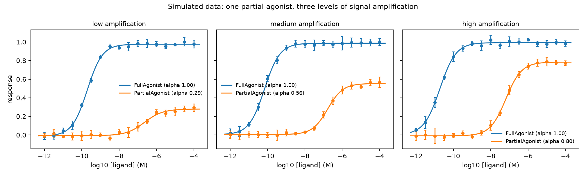

# pharmfit

Concentration–response analysis for receptor pharmacology, in Python.

`pharmfit` fits four-parameter logistic (4PL) curves, reports relative maximal effect (α) and concentration ratios (CR) against a reference agonist with bootstrap confidence intervals, fits the Black & Leff operational model, and runs Gaddum/Schild antagonist analysis. It has a small command-line tool and a test suite.



*Simulated data. The partial agonist never changes; only the amplification of the assay does.*

## Why I wrote it

My master's thesis at the University of Padua characterised a NOP receptor ligand in three cell-based assays. The same compound looked like a weak partial agonist in a proximal G-protein interaction assay and a much more efficacious agonist in cAMP inhibition, a pattern that classical receptor theory explains by different signal amplification. This project turns that lesson into code: it makes the effect reproducible on simulated data and gives a transparent, tested way to fit and compare curves, so that an efficacy statement is never read off a single assay.

This is a new portfolio project, not a reanalysis of thesis data. All example data are **simulated** from the operational model.

## Install

```bash
git clone https://github.com/rahulramalingam123-a11y/pharmfit.git
cd pharmfit
python -m venv .venv && source .venv/bin/activate
pip install -e ".[dev]"
pytest
```

Requires Python 3.9 or newer (numpy, scipy, pandas, matplotlib).

## Quick start

```python
from pharmfit import make_demo_dataset, fit_table

df = make_demo_dataset(seed=7)                      # simulated: assay, ligand, experiment, conc, response
table = fit_table(df, assay="assay", reference="FullAgonist", n_boot=300)
print(table[["assay", "ligand", "logec50", "alpha", "alpha_low", "alpha_high", "cr"]].round(2))
```

Command line, with your own CSV (one row per measurement, molar concentrations):

```bash
pharmfit demo examples/data/simulated_assays.csv
pharmfit fit examples/data/simulated_assays.csv \
    --assay assay --reference FullAgonist --bootstrap 300 \
    --out results.csv --plot fits.png
```

Column names are configurable with `--ligand`, `--conc`, `--response` and `--assay`.

## Example result

Running `python examples/amplification_demo.py` fits 3 assays × 2 ligands × 5 simulated experiments:

| Assay | Partial-agonist α (95% bootstrap CI) | α expected from the model |
| --- | --- | --- |
| low amplification | 0.29 (0.26–0.32) | 0.29 |
| medium amplification | 0.56 (0.53–0.58) | 0.55 |
| high amplification | 0.80 (0.75–0.85) | 0.80 |

The expected values come from the operational model (Emax = τ / (1 + τ) with τ = 0.4, 1.2 and 4 for the partial agonist, against τ = 50, 150 and 500 for the reference), so the fits recover the ground truth within their intervals.

## What is in the package

| Module | Contents |
| --- | --- |
| `pharmfit.models` | `hill` (4PL), `operational` (Black & Leff), `operational_emax`, `operational_ec50` |
| `pharmfit.fit` | `fit_4pl` (with optional fixed bottom, top or slope, standard errors and t-based 95% intervals), `fit_operational`, `relative_efficacy`, `bootstrap_relative` |
| `pharmfit.schild` | `concentration_ratio`, `pa2_single`, `schild_regression` (free-slope and slope-constrained pA2, test of slope = 1) |
| `pharmfit.analysis` | `fit_table`: every ligand in every assay, with α and CR against a reference |
| `pharmfit.simulate` | simulated assays from the operational model |
| `pharmfit.cli` | the `pharmfit` command |

## Methods

- **4PL:** `E = bottom + (top − bottom) / (1 + 10^((logEC50 − log[A]) · slope))`, fitted by bounded nonlinear least squares. Inhibition curves are fitted with `top < bottom`.
- **Relative efficacy and potency:** `α = (top − bottom)_test / (top − bottom)_reference` and `CR = EC50_test / EC50_reference`. The bootstrap resamples the fitted residuals of each curve (rescaled for degrees of freedom), refits both curves and reports percentile intervals.
- **Operational model:** `E = Em · τⁿ[A]ⁿ / (([A] + KA)ⁿ + τⁿ[A]ⁿ)`, with `Emax = Em · τⁿ / (1 + τⁿ)` and `EC50 = KA / ((2 + τⁿ)^(1/n) − 1)`. `Em` and `n` are held fixed in `fit_operational`, because they cannot be separated from KA and τ using one partial-agonist curve.
- **Schild analysis:** `pA2 = log10(CR − 1) − log10[B]` for a single antagonist concentration (slope assumed to be 1). `schild_regression` regresses `log10(CR − 1)` on `log10[B]` and reports the free-slope and slope-constrained pA2.

## Validation

`pytest` runs 50 tests covering the model limits and identities (for example, the response at the operational EC50 is half of Emax), parameter recovery from simulated noisy data, a Monte Carlo check that the 95% intervals cover the true logEC50 about 95% of the time, bootstrap intervals, Schild-regression behaviour and the command-line tool. GitHub Actions runs the suite on Python 3.10–3.13.

## Limitations

- The 4PL assumes a single, monophasic curve; biphasic, biased or allosteric behaviour needs other models.
- Fits are per curve, not global, so shared parameters (for example a common bottom across assays) are not constrained.
- The residual bootstrap assumes roughly exchangeable residuals; strongly heteroscedastic data would call for a weighted fit.
- The bundled data are simulated and demonstrate the method, not any real compound.

## Roadmap

Global fitting across assays with shared KA, weighted fits, Schild analysis driven directly from raw curves, and an `operational` command in the CLI.

## Author and AI assistance

Rahul Ramalingam, M.Sc. Pharmaceutical Biotechnology (University of Padua). This project was developed by me and assisted with Claude (Anthropic) for tests; the design choices, the pharmacology and the validation are described above so that every claim can be checked by running `pytest`.

## License

MIT, see `LICENSE`.
